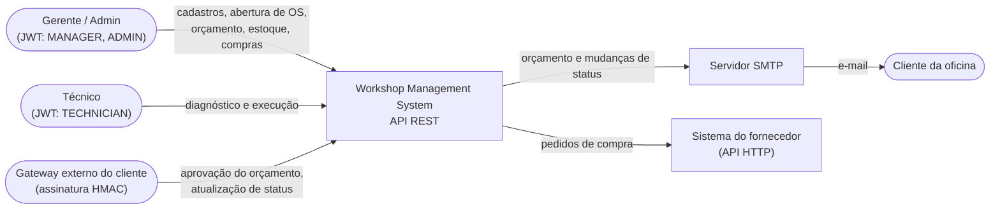
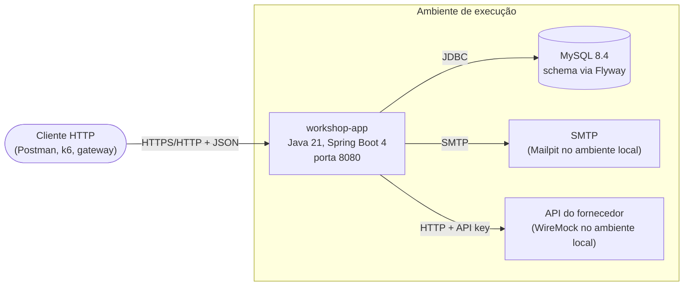
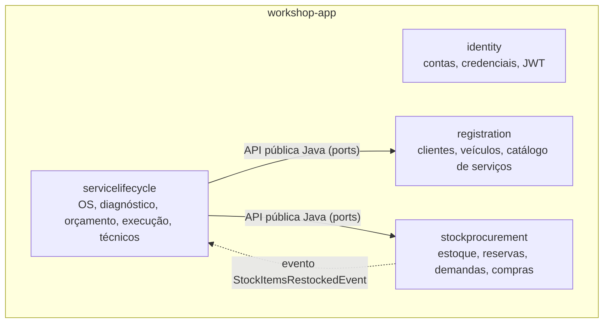
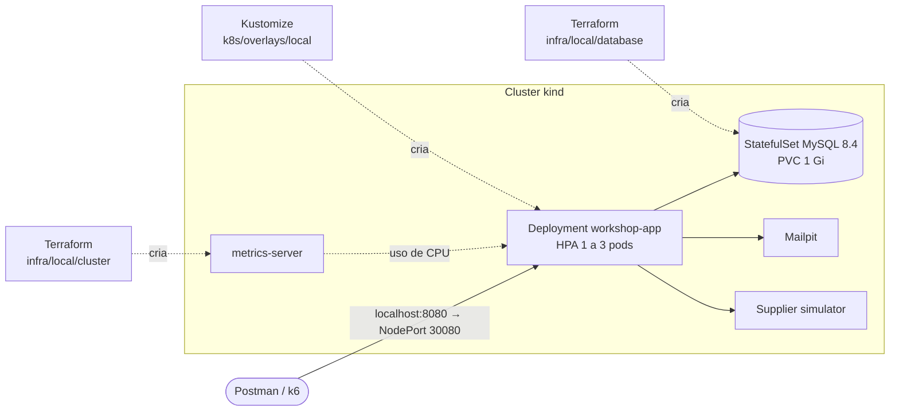
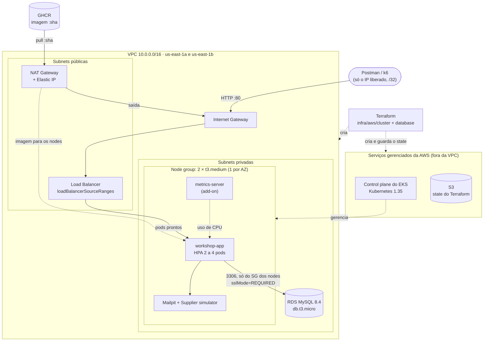
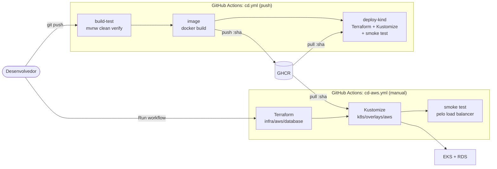

# Visão geral da arquitetura

Porta de entrada da arquitetura do Workshop Management System. Os diagramas seguem o [modelo C4](https://c4model.com):
cada nível aproxima o zoom e responde a uma pergunta. O detalhe de cada assunto fica no documento indicado em
[Para aprofundar](#para-aprofundar), e este arquivo só aponta para ele.

| Nível | Pergunta |
| --- | --- |
| [1. Contexto](#1-contexto) | Quem usa o sistema e com quais sistemas externos ele conversa? |
| [2. Containers](#2-containers) | Quais processos rodam e como se comunicam? |
| [3. Componentes](#3-componentes-módulos) | Como a aplicação se divide por dentro? |
| [4. Implantação](#4-implantação) | Onde cada processo roda, do PC à pipeline e à AWS? |

## 1. Contexto

- **Autenticação:** usuários internos usam JWT com papéis (`MANAGER`, `ADMIN`, `TECHNICIAN`, `CUSTOMER`), conforme a
  [ADR-003](../adr/ADR-003-authentication-strategy.md). Sistemas externos assinam a requisição com HMAC, conforme a
  [ADR-007](../adr/ADR-007-external-gateway-hmac-authentication.md).
- **Acompanhamento da OS:** é feito por consulta (polling) ao endpoint de status, sem WebSocket, conforme a
  [ADR-002](../adr/ADR-002-realtime-updates-strategy.md).

## 2. Containers

| Container | Responsabilidade | Observações |
| --- | --- | --- |
| `workshop-app` | Toda a regra de negócio, num único processo | Monólito modular; health checks em `/actuator/health/{liveness,readiness}` ([detalhes](../operations/health-checks.md)) |
| MySQL | Persistência transacional | Escolha justificada na [ADR-001](../adr/ADR-001-escolha-do-banco-de-dados.md); o schema só muda por migration Flyway |
| SMTP | Entrega de e-mails ao cliente | Saída opcional: com `APP_NOTIFICATION_EMAIL_CHANNEL=log`, os e-mails vão para o log ([ADR-004](../adr/ADR-004-notifications-boundary.md)) |
| API do fornecedor | Recebe pedidos de compra | No ambiente local, é simulada pelo WireMock com os mapeamentos de `docker/wiremock/mappings` |

A aplicação recebe banco, SMTP e segredos por variáveis de ambiente (contrato em
[Configuração](../setup/configuration.md)). Por isso a mesma imagem roda no Docker Compose, no kind e na AWS.

## 3. Componentes (módulos)

A aplicação é um **monólito modular**: um processo e um deploy, divididos em módulos do
[Spring Modulith](https://spring.io/projects/spring-modulith) que seguem os bounded contexts do domínio. O
`ModuleStructureTest` verifica as fronteiras a cada build. Uma dependência proibida reprova os testes.

| Módulo | Responsabilidade |
| --- | --- |
| `identity` | Contas, credenciais e o mapeamento papel → ID de domínio usado no JWT. Não importa tipos de outros módulos |
| `registration` | Clientes, veículos e catálogo de serviços (com arquivamento lógico) |
| `servicelifecycle` | Ordem de serviço do início ao fim: abertura, diagnóstico, orçamento, aprovação, execução, entrega e notificações ao cliente |
| `stockprocurement` | Itens de estoque, reservas, baixo estoque, demandas e pedidos de compra ao fornecedor |

**Regras de integração** ([ADR-005](../adr/ADR-005-inter-module-integration-contract.md)):

- **Chamada síncrona:** o consumidor define uma *port* (interface) na própria camada de aplicação, e um *adapter*
  chama a API pública do outro módulo (`application/api`, exposta como *named interface*). Os módulos não usam REST
  interno entre si nem importam pacotes internos uns dos outros.
- **Reação a eventos:** eventos Spring, consumidos em geral depois do commit de quem publicou
  (`@TransactionalEventListener(AFTER_COMMIT)` ou `@ApplicationModuleListener`). Exemplo: quando o estoque é
  reabastecido, o `servicelifecycle` tenta de novo as reservas de material pendentes.
- **Sem ciclos:** as setas sólidas só saem do `servicelifecycle`; o caminho de volta é sempre por evento.

**Camadas dentro de cada módulo** (Clean Architecture / hexagonal):

| Camada | Conteúdo | Pode depender de |
| --- | --- | --- |
| `domain` | Aggregates, entidades, value objects e contratos de repositório, sem Spring nem JPA | nada |
| `application` | Casos de uso, ports, DTOs e fronteira transacional (`@Transactional`) | `domain` |
| `infrastructure` | Controllers REST, adapters JPA, SMTP e HTTP | `application`, `domain` |

A árvore de pacotes completa está em [PROJECT-STRUCTURE.md](../PROJECT-STRUCTURE.md).

## 4. Implantação

### 4.1 Kubernetes local (kind)

Quem cria o quê: o Terraform cria o cluster, o metrics-server (namespace `kube-system`), o namespace `workshop` e o
banco; o Kustomize cria a aplicação e os simuladores dentro de `workshop`.

### 4.2 AWS Academy (EKS + RDS)

Infraestrutura provisionada na região `us-east-1` do Learner Lab. O Terraform cria a rede e o cluster
(`infra/aws/cluster`, 17 recursos) e depois o banco e os objetos de conexão (`infra/aws/database`, 8 recursos), com o
state num bucket S3. O Kustomize (`k8s/overlays/aws`) cria a aplicação; o load balancer é criado pela AWS a partir do
Service `LoadBalancer`. Recursos, comandos e custo: [Ambiente AWS Academy](../setup/aws-academy.md).

Escolhas que o diagrama mostra:

- **Nodes e RDS nas subnets privadas:** não têm IP público. Os nodes saem para a internet (imagem no GHCR) pela NAT; o
  RDS só aceita a porta 3306 vinda do security group dos nodes.
- **Um único NAT** (em us-east-1a) para economizar crédito; se essa AZ cair, os nodes perdem a saída para a internet.
  Aceito num ambiente descartável.
- **Load balancer restrito a um `/32`:** a conta `admin` de bootstrap existe em todos os ambientes, então a API não fica
  aberta para a internet inteira.
- **Nodes fixos, pods elásticos:** o HPA escala os pods entre 2 e 4; os 2 nodes não escalam (fora de escopo).
- **Sem roles novas de IAM:** o cluster e os nodes usam a `LabRole` fornecida pelo lab.

### 4.3 Pipelines de entrega

O `cd.yml` roda a cada push na branch de entrega: publica a imagem e a testa num cluster kind criado e descartado
dentro do próprio runner. O `cd-aws.yml` é disparado manualmente, com o cluster EKS já criado: implanta no EKS a
imagem publicada pelo `cd.yml`. Detalhes em [CI/CD](../operations/ci-cd.md).

### 4.4 Ambientes

| Ambiente | Para que serve | Como sobe | Guia |
| --- | --- | --- | --- |
| Docker Compose | Desenvolvimento do dia a dia | `docker compose up -d --build` | [Execução local com Docker Compose](../setup/local-docker-compose.md) |
| kind (local) | Reproduzir o Kubernetes no PC: probes, rolling update, HPA | Terraform (cluster e banco) + Kustomize | [Ambiente Kubernetes local](../setup/local-kubernetes.md) |
| kind (pipeline) | Provar a cada push que a imagem sobe e responde | `cd.yml`, num cluster criado e descartado no runner | [CI/CD](../operations/ci-cd.md) |
| AWS Academy | Ambiente em nuvem (EKS + RDS), acessível pela internet a partir de um IP liberado | Terraform (rede, cluster e banco) + Kustomize ou `cd-aws.yml` | [Ambiente AWS Academy](../setup/aws-academy.md) |

Decisões que valem para todos os ambientes:

- **Uma imagem, várias configurações:** a imagem é a mesma em todos os ambientes, com tag pelo SHA do commit. O que
  muda é o overlay do Kustomize e as variáveis de ambiente.
- **Dono único de cada recurso:** o Terraform cria o cluster, o namespace e o banco; o Kustomize cria só os recursos
  da aplicação. Assim, um `kubectl delete -k` nunca apaga o banco.
- **Escala horizontal:** o HPA ajusta o número de pods pela CPU, com o metrics-server como fonte das métricas (1 a 3
  pods no kind, 2 a 4 na AWS).

## Para aprofundar

| Assunto | Documento |
| --- | --- |
| Requisitos, domínio (DDD), aggregates e linguagem ubíqua | [Architecture.md](../Architecture.md) |
| Registro de decisões de time (AD-xxx) | [Architecture-Decisions.md](../Architecture-Decisions.md) |
| Pacotes e camadas por módulo | [PROJECT-STRUCTURE.md](../PROJECT-STRUCTURE.md) |
| Especificações de cada feature (SDD) | [docs/features](../features/README.md) |

Decisões arquiteturais registradas (todas `Accepted`):

| ADR | Decisão |
| --- | --- |
| [001](../adr/ADR-001-escolha-do-banco-de-dados.md) | MySQL como banco relacional e transacional |
| [002](../adr/ADR-002-realtime-updates-strategy.md) | Acompanhamento da OS por polling, sem WebSocket |
| [003](../adr/ADR-003-authentication-strategy.md) | Spring Security + JWT |
| [004](../adr/ADR-004-notifications-boundary.md) | Notificação é uma saída de cada módulo, não um bounded context |
| [005](../adr/ADR-005-inter-module-integration-contract.md) | Integração entre módulos por ports Java, sem REST interno |
| [006](../adr/ADR-006-average-service-execution-time.md) | Semântica do tempo médio de execução dos serviços |
| [007](../adr/ADR-007-external-gateway-hmac-authentication.md) | HMAC para sistemas externos (webhook) |
| [008](../adr/ADR-008-estrategia-de-ambientes-kind-local-e-aws.md) | Kubernetes local com kind primeiro, AWS Academy depois |
